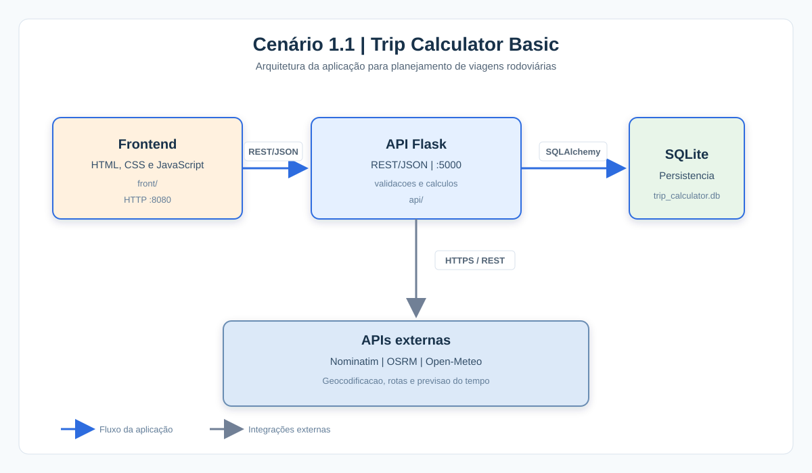

# Trip Calculator Basic

Trip Calculator, com backend Flask e frontend estático.

## Arquitetura



O frontend estático se comunica com a API Flask por REST/JSON. A API valida os dados, realiza os cálculos, persiste os planejamentos em SQLite e consulta as APIs externas de geocodificação, rotas e clima.

## Estrutura

- `api/`: backend Flask e SQLite.
- `front/`: frontend estático com HTML, CSS e JavaScript puro.

O frontend chama a API em `http://localhost:5000/api`.

## Execução local

### API

```bash
cd api
python -m venv .venv
.venv\\Scripts\\activate
pip install -r requirements.txt
python app.py
```

### Frontend

Com a API em execução, sirva a pasta `front` com um servidor HTTP simples:

```bash
cd front
python -m http.server 8080
```

Abra `http://localhost:8080` no navegador.

O endereço da API pode ser alterado na constante `API_URL` de `front/app.js`.

## Docker

```bash
docker build -t trip-calculator-basic-api ./api
docker run -d --name trip-calculator-basic-api -p 5000:5000 trip-calculator-basic-api

docker build -t trip-calculator-basic-front ./front
docker run -d --name trip-calculator-basic-front -p 8080:80 trip-calculator-basic-front
```

Depois, acesse `http://localhost:8080`.

## Funcionalidades

O frontend oferece dashboard, nova viagem, cálculo sem persistência, salvar, histórico com filtros, detalhes, edição e exclusão.
